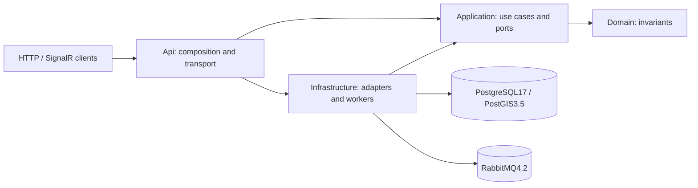

# OrderFleet

OrderFleet is a .NET10 restaurant ordering and courier dispatch backend. It coordinates trusted catalog pricing, payment authorization/capture, restaurant deadlines and concurrent courier assignment while preserving durable recovery obligations when processes or dependencies fail.

It is a modular monolith with Clean Architecture: Domain, Application, Infrastructure and Api. PostgreSQL/PostGIS stores authoritative state; RabbitMQ transports committed integration facts. Payments are a durable mock and never process real money.

## Features

- Immutable SAR order snapshots, guarded state transitions and private delivery destinations.
- ASP.NET Core Identity/JWT, live privileged-role and restaurant membership authorization, restricted audited onboarding APIs.
- Actor-scoped order-create replay, trusted catalog revalidation and optimistic concurrency.
- Idempotent mock authorization/capture/void/refund, uncertain-outcome reconciliation and immutable financial archive.
- PostGIS courier discovery, atomic claims, unique active capacity and AssignmentId fencing.
- Transactional Outbox/Inbox, confirmed publication, durable delayed outage retries and poison-message visibility.
- Persisted acceptance/pickup deadlines, dispatch retries and cancellation/payment recovery.
- Authorized SignalR snapshots, assignment-aware GPS throttling and approximate ETA.
- Explicit frontend origins, WebSocket Origin checks, trusted-proxy configuration and per-actor request limits.
- Privacy-safe logs/traces, OpenTelemetry metrics, worker/dependency health and live-Admin operations.
- Real PostgreSQL/PostGIS/RabbitMQ integration tests, migration verification and an executable delivery journey.

## Architecture and stack



The stack includes C#14, EF Core10/Npgsql, ASP.NET Core Identity, SignalR, Serilog, OpenTelemetry and xUnit/Testcontainers. No Redis or broker framework is required. [Architecture](docs/02_ARCHITECTURE.md) explains the boundaries and [the study guide](docs/09_LEARNING_GUIDE.md) follows the important files.

## Run locally

Prerequisites: the .NET10 SDK selected by global.json, Docker Linux containers, PowerShell7 and Git. From the checkout root:

```powershell
pwsh -File ./scripts/Bootstrap.ps1 -ProjectName orderfleet-demo
pwsh -File ./scripts/Invoke-Demo.ps1 -BaseUrl http://127.0.0.1:8080
```

Bootstrap creates missing cryptographically random credentials in ignored .env, builds the image, starts its PostGIS/RabbitMQ, explicitly migrates/seeds and checks health. It preserves existing credentials/data and never implicitly upgrades the legacy database. Invoke-Demo exercises trusted pricing/replay, role/ownership denial, capture, dispatch, fenced pickup/delivery and ETA. Neither script prints passwords, tokens or private response bodies.

Default loopback ports: API8080, PostGIS5434, RabbitMQ5672 and management15672. Set API_PORT, POSTGIS_PORT, RABBITMQ_PORT and RABBITMQ_MANAGEMENT_PORT to free ports when needed;0 chooses ephemeral ports. Use a new orderfleet-* project for an independent dataset. Stop without deleting data:

```powershell
docker compose --project-name orderfleet-demo --profile app stop
```

Do not attach a PostGIS image to an existing plain-PostgreSQL volume. The legacy profile preserves the old developer service on5433. Back up real data and review every migration before upgrading a populated database. The API does not migrate/seed during normal startup; explicit --migrate and Development-only --seed-demo are separate commands.

## Configuration

Use private environment configuration or User Secrets. Never commit .env, signing keys, passwords or local connection strings; .env.example contains placeholders. Do not print resolved Compose configuration or full container environments.

| Setting | Behavior/default |
|---|---|
| ConnectionStrings:OrderFleet | Required PostgreSQL connection; not a developer DB in tests |
| Jwt:Issuer/Audience/SigningKey | Required; HS256, key at least32 bytes, lifetime15 minutes |
| Messaging:Uri | Private AMQP URI; durable RabbitMQ required for runtime delivery |
| Cors:AllowedOrigins | Exact frontend origins, default empty; environment array key Cors__AllowedOrigins__0 |
| TrustedProxy:Enabled/KnownProxies/KnownNetworks | Disabled by default; explicit one-hop trust, no /0 |
| RequestLimits:CreatePerMinute/WritePerMinute/ReadPerMinute/HubPerMinute | 10/60/120/60; per actor, no queue; hub budget spans connections |
| Ordering:AcceptanceTimeoutMinutes | 5, persisted per order |
| Dispatch:PickupTimeoutMinutes | 5, persisted per assignment |
| CourierLocationEvents:MinimumDistanceMeters/MinimumIntervalSeconds | 25m OR10s, active assignment only |
| Cleanup:Enabled/PublishedOutboxDays/ResolvedRecoveryDays/FinishedDispatchDays | Eligible technical cleanup; minimum7/30/30 days |
| Demo:Enabled | Required acknowledgement outside Development/Testing; provider still a mock |
| AllowedHosts | Localhost/127.0.0.1 default; explicit non-wildcard deployed hosts |

Frontend example: Cors__AllowedOrigins__0=https://frontend.example.test. HTTPS origins and issuer are mandatory outside local/test environments. Terminate TLS correctly and configure proxy trust explicitly; HSTS/HTTPS redirect apply outside local/test. Responses label payments as mock. There is no real payment provider to enable.

See [operations](docs/13_DELIVERY_GUIDE.md) for exact option names/bounds, secret rotation, telemetry, retry/DLQ inspection and recovery. Changing .env alone does not change credentials in initialized database/broker volumes.

## API and onboarding

Development/Testing OpenAPI: /openapi/v1.json. Public health: /health/live and /health/ready. Authentication: /api/v1/auth/register, /login and /me. Requests use Bearer JWTs. Registration grants Customer only. Demo credentials stay private in .env; six Development-only demo accounts exercise separate roles.

Customer creates an order from product IDs/quantities and destination using Idempotency-Key, then reads/lists their own orders. Restaurant members accept/reject; a courier discovers its active assignment through /api/v1/couriers/me/orders and supplies the current assignmentId for pickup/delivery/release.

Only current Admin may grant/revoke other users' RestaurantOwner/RestaurantStaff/Courier roles. No HTTP endpoint administers Admin. Current restaurant owners manage eligible memberships only within their restaurants. A target user shares their own ID from /auth/me; no public user directory is exposed. Mutations are audited and concurrency-safe. Reauthenticate to acquire a newly granted role; revocation is checked live.

Full routes, errors, pagination, events and SignalR behavior: [API contracts](docs/11_API_DATA_CONTRACTS.md).

## Build and test

```powershell
dotnet restore OrderFleet.slnx
dotnet build OrderFleet.slnx -c Release --no-restore -m:1 -warnaserror
dotnet format OrderFleet.slnx --verify-no-changes --no-restore --verbosity quiet
dotnet test OrderFleet.slnx -c Release --no-build --no-restore -m:1
pwsh -File ./scripts/Verify-Migrations.ps1
```

Docker is required for Integration tests. They use disposable PostGIS/RabbitMQ and actual migrations, never a developer database. The latest full local regression passed260 Domain+302 Integration=562 cases,0 failed/skipped. Independent test collections are capped at two to bound shared Docker pressure; explicit concurrent sessions/barriers remain enabled. [Testing](docs/05_QUALITY_GATES.md) and [release verification](docs/16_RELEASE_VERIFICATION.md) distinguish executed local evidence from remote CI and operational readiness.

## Engineering tradeoffs and limits

- Delivery is at least once with idempotent effects; no global broker-order or end-to-end exactly-once guarantee.
- Mock payments, heuristic straight-line ETA and simple active/available catalog flags are deliberate boundaries.
- Realtime supports one API instance. A tested backplane plus authorization-registry/fanout design is needed for replicas; notifications require snapshot refresh after reconnect.
- HTTP/Inbox deduplication identities are retained indefinitely. Cleanup protects unresolved work and immutable financial/order audit. Approve a replay horizon before production pruning.
- Lists use bounded OFFSET; deep pages can be expensive. Some exact operational counts/cancellation scans remain history-sensitive; synthetic100k/300k plans are not a production SLA.
- Duplicate registration timing and account-lockout tradeoffs remain documented. In-process rate limits do not replace edge/DDoS controls.
- Production identity governance, real-provider reconciliation, scale, backup/restore drills and operational certification remain outside local test success.

Explore [documentation](docs/00_START_HERE.md), [decisions](docs/08_DECISION_LOG.md) and [security](docs/06_SECURITY_AND_RELIABILITY.md).
