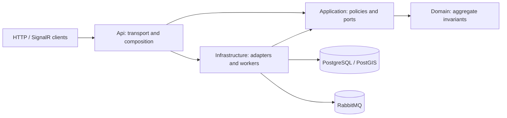

# Architecture

OrderFleet is one deployable modular monolith. Feature folders separate ordering, payments, catalog, couriers, dispatch and recovery without introducing separate databases or services.

Domain has no transport or persistence dependencies. Application references Domain and defines use cases/ports. Infrastructure implements EF storage, spatial queries, broker transport, mock-provider ledger and background workers. Api owns identity transport, endpoint binding, browser policy, SignalR and dependency registration. ArchitectureTests verifies the assembly boundary.

## Units of work

One scoped EfOrderingStore implements creation, transition and query capabilities. These interfaces do not create separate transactions. OrderTransitionEffects shares its caller's DbContext and transaction and applies courier, dispatch-job and assignment-history effects before the existing single SaveChanges and Outbox staging. It never commits independently.

Order creation rechecks catalog data under stable restaurant/product share locks before saving snapshots, payment, destination/deadline, request identity, audit and Outbox together. Order updates retain original xmin tokens. OrderLocking distinguishes loading a root for update from locking an already tracked root without overwriting its original concurrency token.

Business lock order is Order then Courier; multi-root operations sort identifiers. Identity administration separately locks actor/target users in sorted order, then the restaurant when managing memberships. Authority is rechecked after these locks; mutation and audit commit together. No database lock is held while publishing to RabbitMQ.

## Reliable boundaries

The durable mock provider intentionally uses independent transactions to model an external system. Local rollback cannot undo its committed capture. Stable operation identities, reconciliation and cancellation compensation close that gap.

Outbox rows share business commits. Multiple relays claim with SKIP LOCKED and lease fences, publish persistent mandatory events with confirms, then mark publication. Confirmed publication followed by a failed DB acknowledgement leaves the lease for recovery. Broker outages retain bounded delayed retries indefinitely; invalid envelopes dead-letter. Consumers commit effects and Inbox together before ACK. Delivery is at least once; neither publication nor broker arrival has a global ordering guarantee.

FinancialAuditRecords archive typed immutable facts atomically with their consumer Inbox. They are history, not payment authority. Customer destinations never enter unrestricted integration events. Courier coordinates are read from authorized current state when notifying clients.

CourierPosition is an intentional PostGIS projection, not a second authority. Its current position and durable event-throttle checkpoint update in the same transaction as the courier aggregate. Unique active-capacity indexes and AssignmentId checks fence stale work.

Recovery derives actionable work from persisted deadlines, states and obligations. Operational worker progress and broker observations are process-local diagnostics, not business state. SignalR's connection/subscription registry is also transport state; authorization is checked live before subscription and notification.

See [decisions](08_DECISION_LOG.md), [code study paths](09_LEARNING_GUIDE.md) and [operations diagrams](13_DELIVERY_GUIDE.md).
