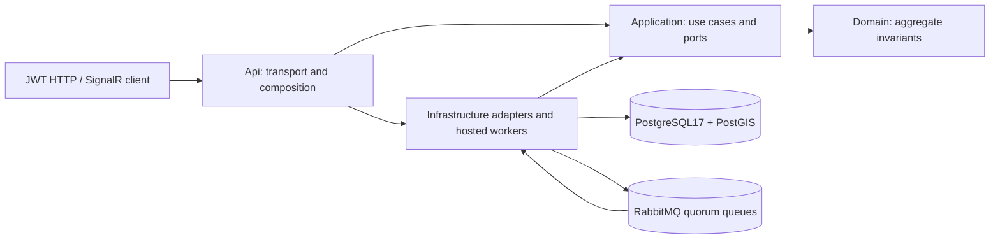
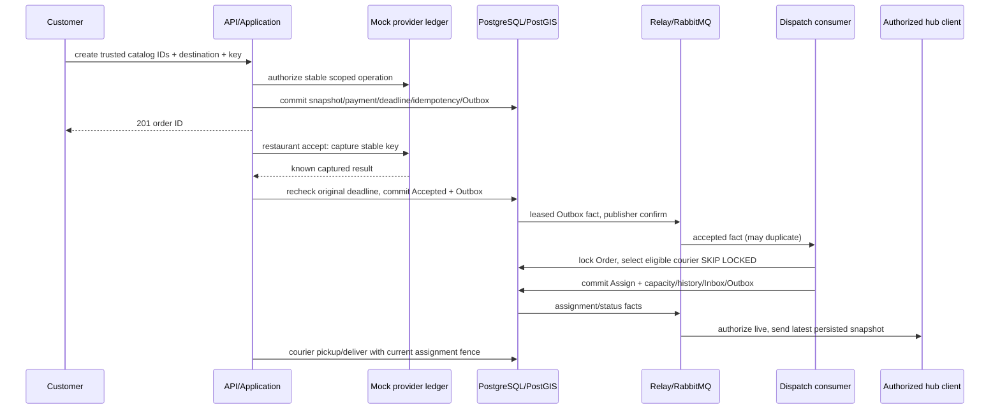
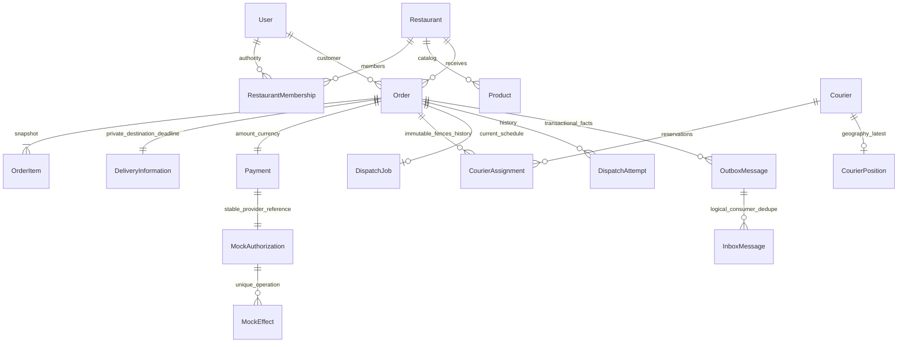

# Delivery guide and operator walkthrough

## Local provisioning and credentials

Use PowerShell7 and Docker Linux containers. Run `scripts/Bootstrap.ps1` from the checkout root. Image tags/digests are pinned in Dockerfile/Compose; the app image has no SDK, source, secrets or build tools. It runs UID1654 with read-only root, bounded tmpfs and resources. Original legacy PostgreSQL is a separate preserved service, never an implicit app dependency.

The bootstrap generates missing credentials in ignored `.env` from cryptographic randomness, validates Compose without printing resolved configuration, then builds, starts dependencies, stops its API, migrates, seeds, starts API and checks health. Existing values/data/passwords are preserved. Repeating seed does not rotate passwords. If seed detects an existing unrelated identity with a demo email, it rolls back rather than granting roles. Fix the collision deliberately in a disposable environment; never erase owner accounts automatically.

The API never migrates or seeds as part of ordinary server startup. Explicit commands for an already built app project:

```powershell
docker compose --project-name orderfleet-demo --profile app run --rm --no-deps api --migrate
docker compose --project-name orderfleet-demo --profile app run --rm --no-deps api --seed-demo
```

Stop the app before schema migration. Back up real data and review migrations before any non-demo upgrade. No down-migration/reset procedure is automated. To start a fresh local dataset use a new Compose project and unused ports, preserving the prior volumes. Rotate credentials deliberately across database/broker/app together: changing `.env` alone does not change credentials already persisted in their volumes. Do not print `docker compose config` or full container environment: use `config --quiet` and narrow inspect fields.

## Manual authenticated calls

The following PowerShell keeps secrets/tokens in process variables. Read your own ignored `.env` privately; avoid shell transcripts or logging response objects containing tokens.

```powershell
$base = 'http://127.0.0.1:8080'
$password = Read-Host 'Local demo password' -MaskInput
$login = Invoke-RestMethod "$base/api/v1/auth/login" -Method Post -ContentType application/json -Body (@{email='customer@demo.orderfleet.test';password=$password}|ConvertTo-Json)
$customer = @{Authorization="Bearer $($login.accessToken)"}
Invoke-RestMethod "$base/api/v1/auth/me" -Headers $customer
$restaurants = Invoke-RestMethod "$base/api/v1/restaurants"
$restaurant = $restaurants | Where-Object name -eq 'OrderFleet Demo Kitchen'
$products = Invoke-RestMethod "$base/api/v1/restaurants/$($restaurant.id)/products"
$meal = $products | Where-Object name -eq 'Demo Meal'
$create = $customer.Clone()
$create['Idempotency-Key'] = [Guid]::NewGuid().ToString('N')
$body = @{restaurantId=$restaurant.id;items=@(@{productId=$meal.id;quantity=2});latitude=24.72;longitude=46.68}|ConvertTo-Json -Depth 5
$order = Invoke-RestMethod "$base/api/v1/orders" -Method Post -Headers $create -ContentType application/json -Body $body
Invoke-RestMethod "$base/api/v1/orders/$($order.id)" -Headers $customer
```

Create201 returns `{ "id": "<order-guid>" }`; its GET shows status Created, currency SAR, totalAmount51 and immutable item snapshot25.50×2. Precise customer destination is only in the authorized `/delivery` resource. Client price/customer/courier authority fields are rejected; unknown JSON properties400. Repeating the same scoped create key/body returns the same ID201, changed body409. Keys are1..100 non-control characters. Supply lat[-90,90] and lon[-180,180]; omitting either400. Coordinate values above are synthetic demo inputs.

Use owner login to POST `/api/v1/orders/{id}/accept` (no body). It captures the stable provider operation before accepting; successful204. Permanent decline409 is replayed; confirmed transient503 can retry before original deadline; unknown503 reconciles provider status/idempotency rather than charging again. The worker eventually assigns a fresh available courier. Courier login sends PUT `/api/v1/couriers/me/availability` with `{ "isAvailable": true }`, PUT `/location` with latitude,longitude,observedAt UTC, then POST `/orders/{id}/pickup` and `/deliver` with `{ "assignmentId": "<current-fence>" }`. Repeated terminal operations409. A different actor sees404 for private resources or403 for forbidden roles. The complete executable version is `scripts/Invoke-Demo.ps1`.

Public registration grants Customer only. Restaurant owner/staff/admin/courier privileges come from controlled identity provisioning, not request bodies. Tokens have issuer/audience/signature/algorithm/lifetime validation,15-minute default life and30s skew; no refresh token. Restaurant membership is live; ordinary role grants follow the token-expiry policy. Operations and realtime additionally recheck current DB roles. Credential endpoints allow10 requests/IP/min and lock accounts after5 failed attempts.

## System boundaries



Domain/Application reference no EF, Npgsql, RabbitMQ or ASP.NET assemblies (ArchitectureTests). Infrastructure owns EF projections, spatial queries, leases, broker transport and payment ledger. Api owns JWT, endpoints, SignalR connection state and safe exporter configuration. The singleton connection registry contains bounded transport subscriptions, never business state. Workers create fresh scopes/contexts per delivery/sweep. Explicit relational transactions couple aggregates, technical scheduling, audit and Outbox; no network publication inside the DB commit.





The diagram shows logical associations; Outbox/Inbox intentionally do not require FK coupling across message retention. `Orders.xmin` detects stale saves. Partial unique indexes prevent a courier from belonging to two active Assigned/PickedUp orders. Current courier capacity has unique current order/fence. Root locking always precedes courier locks. PostGIS geography(Point,4326) uses longitude X/latitude Y, meters, ST_DWithin, GiST; radius/freshness/availability and distance+ID tie-break are bounded.

## Failure and recovery contract

| Failure | Durable response | Verification |
|---|---|---|
| Concurrent create/same scoped key | one Order/payment, matching replay; changed request409 | CatalogOrderingApiTests, PaymentWorkflowTests |
| Capture response lost | provider stable idempotency + read reconciliation, no second charge | PaymentWorkflowTests, RecoveryTests |
| Capture finishes after original deadline | never accept; timeout cancel and refund captured result | PaymentWorkflowTests, RecoveryTests |
| Process dies after DB commit | Outbox remains pending, reclaimed after lease | OutboxLeaseTests, RabbitDeliveryTests |
| Broker confirm before Outbox mark | duplicate publication possible, Inbox/effect dedupe | RabbitDeliveryTests |
| Consumer commits then dies before ACK | redelivery, one logical effect | RabbitDeliveryTests |
| Two dispatch workers/capacity collision | DB lock/unique constraint + xmin, one compatible claim | DispatchConcurrencyTests |
| Old assignment/timeout arrives | current courier+AssignmentId fence rejects stale work | Domain assignment, DispatchConcurrencyTests, RecoveryTests |
| One corrupt recovery item | persisted backoff/dead letter, unrelated items proceed | RecoveryFailureIsolationTests |
| API restarts mid-delivery | assignment/payment persist; reconnect rereads latest snapshot | EndToEndJourneyTests |
| DB/broker unavailable | ready503 bounded, live200; durable work retries | OperationsApiTests, RabbitDeliveryTests |

Acceptance deadline is frozen at create UTC (default5m); both command and worker enforce it. Pickup deadline is frozen per assignment (default5m); only unpicked current Assigned reservations expire. No timeout forcibly releases PickedUp. Dispatch attempts cap10 per cycle and3 assignment cycles by default; exhaustion is an operational job state, not a new Order status/reason. Candidate retry uses exponential backoff capped300s plus deterministic per-order jitter. Recovery scans bounded20 per sweep; item failures back off2^attempt capped300s,10 default then dead. Invalid invariants dead letter immediately. Existing Order cancellation matrix is unchanged; no silent replacement statuses or cancellation reasons.

Outbox claims max5 with60s lease and5s bounded publishes; token and unexpired deadline fence completion/failure. Broker main queues are durable quorum; confirms+mandatory routing precede Outbox mark. Consumers ACK after durable effects; retry delays1/5/30/120s then dead after fifth failure, poison immediately. Copy confirms before original ACK; failed republish closes/requeues. This is at-least-once transport, never a general exactly-once guarantee.

## Operator runbook

`/health/live` proves process response. `/health/ready` checks actual PostgreSQL connectivity/migration state, AMQP and required worker progress with2s internal/3s dependency bounds. Public503 contains no raw details. Worker states are Starting/Running/Failed/Stalled/Stopped/Disabled. Defaults: startup grace60s, stalled progress90s, persistent failure grace30s, idle AMQP probe5s; configure WorkerHealth__StartupGraceSeconds/StallSeconds/FailureGraceSeconds/ProbeSeconds. Successful empty sweeps and verified empty-queue connections count as progress. Socket probes cannot conceal a busy stalled handler. Stop/Disabled is immediately unready. Transient failure/startup grace avoids unnecessary disruption; persistent failures do not renew grace on retry. Liveness is process-only; do not use readiness as a restart probe. These are observable readiness signals, not an HA/SLA guarantee.

Admin uses GET `/api/v1/operations/runtime` for safe worker states/last success/progress age and observed main/retry/dead queue counts; this route rechecks live Admin authority. Queue counts are ready messages, not unacked, with observation timestamps. Admin also uses GET `/api/v1/operations/summary`, `/outbox?state=dead&page=1&pageSize=20`, `/recovery-failures?state=dead&page=1&pageSize=20`. Inspect controlled codes/counts and underlying cause before retry. POST `/outbox/{messageId}/retry`, `/orders/{orderId}/retry-dispatch`, or `/recovery/{operation}/{resourceId}/retry` with a new Idempotency-Key. Same actor/operation/key/target replays204; changed target409. Outbox replay rejects published/actively leased rows. Audit records who/when/target/prior attempts/outcome. Retry changes technical eligibility only; normal Domain and payment/fence guards execute again. Recovery names are listed in API contracts. Broker dead-letter payload replay is not exposed as an unsafe arbitrary-payload HTTP API: diagnose and reconcile the durable business operation through the approved operations above; broker administration needs controlled operator access.

Default Console telemetry exports structured safe logs,10% sampled root traces and metrics every10s. Configure `Telemetry__Exporter=Otlp` and private `Telemetry__OtlpEndpoint` for a local collector; no paid cloud required. Use `None` explicitly only in isolated tests. Metrics include HTTP duration/errors, dispatch result/time, Outbox lag/retries/dead, uncertain payments, recovery pending/dead, worker progress_age/ready and broker ready_messages labeled by controlled consumer/queue.kind. Recovery pending counts unresolved retryable failure records; due dispatch and unsettled cancellation counts are separate summary fields. Unknown Warning/Error logs become controlled source-category/type/event-code incidents; raw exceptions/templates/properties are never sent to sinks. Expected business rejections use debug plus the HTTP summary; handled unexpected500 is logged once. EF20102 identifies command errors without exposing SQL. A fresh migration may emit this coded diagnostic for the initial absent history table before EF creates it; use command completion/history verification to assess migration success. Route templates/controlled codes prevent unbounded cardinality; no tokens, precise destination, SQL, baggage, provider exception messages or connection credentials. Traceparent connects HTTP→DB/application→Outbox→producer→consumer; no tracestate/baggage forwarding. Exporters are tested for redaction. Console stdout is not durable storage: configure bounded platform log retention and monitor ingestion separately.

Alert on growing Outbox lag/dead counts, dispatch exhaustion, uncertain payment/settlement backlog, recovery dead and ready503. Deployment-specific thresholds depend on workload and require owner operations review. Inbox/idempotency/payment effects currently retain their dedupe history; no automatic pruning can invalidate replay safety. Financial events are automatically consumed by financial.archive.v1 into immutable FinancialAuditRecords plus Inbox in one PostgreSQL transaction before broker ACK. This is a historical projection, not another charge or state mutation. IDs/amount/SAR/state/type/version/UTC timestamps are retained without unrestricted payload JSON or coordinates. All six financial event states are validated. Same-message conflicting content is poison; identical duplicate and commit-before-ACK replay archive once. Main/retry/dead queue counts and worker progress are sampled and exported; persistent collection failure retains the last timestamped sample rather than inventing zeros. FinancialAuditRecords has no operational FK cascade; required audit information remains after future operational retention. Establish backup/restore drills, business retention/legal requirements and safe dedupe horizons before any pruning. Never truncate ledgers or queues as a recovery shortcut.

Security patch procedure: inspect official advisories, update explicit package/runtime/image pins, verify downloaded SDK hashes, run package vulnerability audit, build/analyzers/format, all real infra tests, migrations from empty and demo. Scan OS/container packages using the deployment team's selected scanner before release; this repository does not claim a completed image-CVE scan. Keep signing keys/database/broker secrets outside tracked files; local `.env` has user filesystem security only, not a production secret manager. Production needs TLS/proxy configuration, hardened secret delivery, controlled identity administration and an appropriate real payment provider.

## Realtime and ETA limits

Connect bearer-authenticated `/hubs/orders`, invoke `SubscribeOrder(orderId)` and keep the returned latest committed snapshot. Client cannot choose a group. Listen to `OrderUpdated` and `CourierLocationUpdated`; compare Sequence/observedAt and refresh/re-subscribe on reconnect. Every send rechecks expiry/current DB roles, membership and current courier relationship. Browser query bearer token is accepted only on the hub WebSocket/SSE path and excluded from logs. Transport caps:1000 local connections,5 per actor,20 subscriptions/connection,8KiB input; location delivery throttles2s and reads latest persisted position. Customer destination never enters hub/broker payloads.

Single API realtime is a deliberate tested boundary. Multiple business workers are DB-safe; multi-API SignalR requires a tested backplane/fanout before scaling. Notifications are best effort, no durable client receipt. ETA default speed25km/h, distance factor1.3, preparation10m, handoff2m and max120m; fresh location confidence is Approximate, stale/missing Low. Delivered0, Cancelled unavailable. No road/traffic service or location broadcast to strangers.

## Review and evidence

Full phase evidence and failures corrected are in `07_PROGRESS_AND_HANDOFF.md`; named tests are executable evidence, not a substitute for a human review. GitHub workflow is defined but not remotely executed because no push is authorized. Patches, migration target safety, concurrency, privacy, failure recovery and dependency direction were adversarially self-reviewed. Human owner review/merge is still pending; no deployment or production SLA/compliance claim is made. Legacy populated assignments require reviewed history/deadline reconciliation before upgrade; developer DB was preserved unchanged. The solution includes mandatory SignalR, ETA and OpenTelemetry; none were silently deferred.

## Financial dead letters and backlog handling

The healthy financial queue now drains automatically. An outage can build durable backlog; monitor main/retry/dead ready-message depth, sample timestamps, worker progress and Outbox age. Failed archive work uses the same confirmed retry copy before ACK and bounded retry/DLQ policy as other consumers. A poison item dead-letters immediately so later facts progress. No TTL or lossy queue eviction is introduced to hide growth.

After fixing the cause, an authorized broker operator can replay the original retained financial envelope to the financial main queue with its original MessageId/Type and metadata: obtain a publisher confirm before ACK/removing the dead-letter source. Preserve IDs and amounts; never call Capture/Refund to manufacture a missing audit projection. The archive dedupes an already committed fact. For a malformed source, verify the authoritative retained Outbox/provider evidence before a reviewed repair; conflicting archived content must never be overwritten. There is intentionally no arbitrary-payload HTTP replay endpoint. Do not dump dead-letter bodies to unrestricted logs, purge queues, or truncate audit/Inbox history as recovery. Retention, capacity alerts and human resolution of poison remain deliberate operational responsibilities.

The review findings, changed files, exact test/Compose/migration results and remote workflow instructions are in [14_HARDENING_REVIEW.md](14_HARDENING_REVIEW.md).
